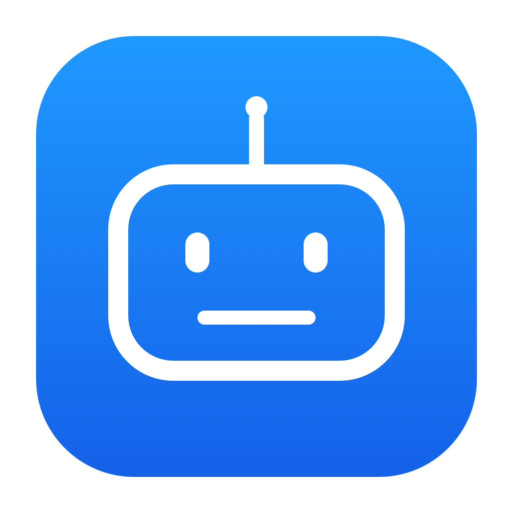
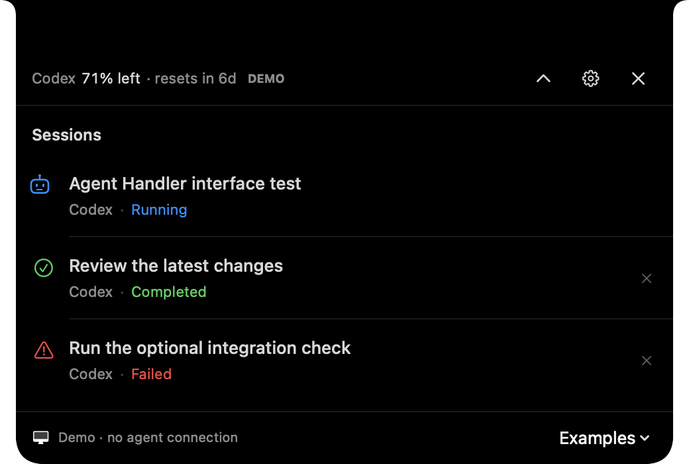

# Agent Handler

A small macOS app that keeps an eye on your agents while you do something else.

See which Codex sessions are running, answer questions and handle supported approvals from the menu bar or notch. The panel can open when something needs you, then get out of the way.

**100% vibe-coded, built for personal use, and provided as is.** I built it when a Codex update broke the similar apps I was using. No warranty or promised support.



## Install

Requires **macOS 14 or later**.

### Homebrew

Moving from an existing copy? Turn off **Launch at login** in that copy and quit it first. The source installer uses `~/Applications` by default; remove that old app bundle before switching to Homebrew so you keep one copy. Preferences and app data can stay.

```sh
brew tap gbettineschi/tap
brew install --cask gbettineschi/tap/agent-handler
open "/Applications/Agent Handler.app"
```

This uses my personal tap, shared with Tetherbug. Re-enable **Launch at login** in the new copy if wanted. To update, quit Agent Handler and run:

```sh
brew update
brew upgrade --cask gbettineschi/tap/agent-handler
```

### Direct download

Download [`AgentHandler.zip`](https://github.com/gbettineschi/agent-handler/releases/latest/download/AgentHandler.zip), unzip it, move **Agent Handler.app** to Applications, and open it. The download supports Apple silicon and Intel. To update, quit the app and replace it in the same location.

The app is ad-hoc signed, not notarized. macOS may block downloaded builds; see [Apple’s instructions](https://support.apple.com/102445) if you choose to open one.

### Build from source

Requires a **matching Swift 6 toolchain and macOS SDK**:

```sh
git clone https://github.com/gbettineschi/agent-handler.git
cd agent-handler
./scripts/install.sh
```

This installs into `~/Applications`. Quit Agent Handler before updating it. To use another folder, pass it to the installer: `./scripts/install.sh /Applications`.

## A few things to know

- Codex local Work sessions are the main supported surface. Regular ChatGPT Chat is not tracked.
- Claude local activity observation is experimental and read-only; answering Claude prompts is not supported.
- The Codex connection uses private Desktop APIs and may break after updates. Uncertain answers are never automatically resent.
- Click the menu-bar agent to open it, or choose **Notch** in Settings and hover. Escape hides the panel; the header’s **× quits the app**.

## Development

`scripts/test.sh` runs the tests. `scripts/bundle.sh` builds the app; `scripts/package.sh` creates a ZIP, checksum and matching Homebrew cask. The **Package macOS app** workflow builds both Mac architectures; a version tag publishes the release. See [release instructions](docs/releasing.md) for keeping the tap up to date.

[Coverage and remaining checks](docs/verification.md) · [Architecture](docs/superpowers/specs/2026-10-19-agent-handler-design.md) · [Third-party notices](THIRD_PARTY_NOTICES.md)
