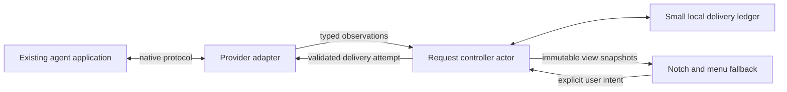

# Agent Handler: first working version

Status: approved by the user on 19 October 2026, including planning and implementation without further review pauses.
Repository destination: **gbettineschi/agent-handler**, private.

## Purpose and success

A small macOS companion that brings an agent's real questions and approval requests to the notch while its user works elsewhere. The source application remains in charge of the agent and its permissions. Agent Handler presents requests and delivers explicit user responses through the source's own protocol.

The user's priorities are correctness, simplicity, local operation, and an unobtrusive notch. The core must accommodate different agents without treating every agent as a terminal coding process. UI polish and provider breadth follow working request handling.

The first useful version handles asynchronous questions from existing Codex/ChatGPT Desktop conversations. This is the specific workflow the user successfully tested with Agent HUD. Other approval mechanisms are separate capabilities, not implicitly covered by that result. The core and test harness exercise both questions and approval choices; live approval support follows a separately verified adapter contract.

Success means two simultaneous questions stay distinct, an answer reaches the correct native request, answering in the source app clears the corresponding card, and a disconnected or incompatible connection never looks like an accepted answer. Restart, cancellation, replay and uncertain delivery have defined behavior and tests.

## Choice of starting point

| Approach | Tradeoff | Decision |
| --- | --- | --- |
| Fresh small Swift core, selectively reuse audited integration utilities | Requires a new request model; avoids carrying unrelated product features | **Use this** |
| Fork all of Open Island | Fast access to its UI, but inherits session/request conflation and competing state ownership | Do not use as the core |
| Fork all of Agent HUD | Has the most relevant tested Desktop question path, but brings much more product scope | Use selected integration code as a reference or attributed adaptation |

Native Swift 6, Swift Package Manager, Foundation, AppKit and SwiftUI. Target macOS 14 or newer. Use system SQLite only for the small delivery ledger. No fetched package dependency is required for the first version. No account, server subscription, telemetry, quota dashboard or agent launcher.

One background application is sufficient. Closing the panel leaves the app running; quitting ends the connection. The core has no UI dependency. A separate daemon, external plugin runtime, cloud relay and general-purpose event bus add no necessary capability at this stage.

## Components and ownership

Four production modules are enough:

- **AgentHandlerCore:** request identities, immutable request descriptions, delivery states, pure state transitions, and the single controller actor. SQLite persistence sits behind a narrow ledger interface.
- **CodexDesktopAdapter:** discovery, private Desktop IPC framing, version checks, state patches, native question parsing, response encoding and receipt validation. It owns all private-protocol knowledge.
- **AgentHandlerApp:** app lifecycle, composition, a small notch panel and a menu-bar fallback. It displays controller snapshots and submits user intents; it does not infer native state.
- **AgentHandlerDiagnostics:** a command-line fixture runner and compatibility/status output. It must work without a real agent account or changing existing agent settings.

Adapters call the controller directly in process. Only genuine external connections use IPC. A second view cannot become a second authoritative state store.

## Identity and source authority

The model distinguishes provider installation, conversation, turn, request, connection and navigation target. A directory or process ID is metadata, never a substitute for a conversation or request identity.

Every actionable request has:

- a stable key: provider installation + native conversation ID + native turn ID where supplied + native request ID;
- the exact native request fingerprint and revision token needed to detect changed content or permissions;
- a route owned by the adapter and tied to the current native owner;
- question or approval content, with stable option IDs and explicit allowed response types;
- provenance, current connection generation, and whether its source state is known and fresh.

String and integer native IDs remain distinct. Fingerprints preserve meaningful request changes and option order. Connection generation fences delayed messages but is **not** part of the durable request identity: reconnecting must not make an uncertain answer eligible for another automatic send.

For version one there is one authoritative actionable source per conversation: its verified Desktop owner stream. Discovery supplies candidate conversation IDs only. A log entry, process, modification time, notification or inferred waiting flag cannot create an answerable request, resolve one, or authorize a response.

Observations carry their scope and sequence. A complete, valid snapshot may withdraw missing requests within that scope. A partial snapshot, parser error, connection loss or revision gap means **unknown**, not an empty request set. Old-generation and out-of-order observations are ignored. A snapshot from one conversation cannot clear another's requests.

There is no universal numerical ranking of all future sources. A later adapter must state which native facts it can establish and how those facts expire or are superseded. Additional sources require explicit reconciliation tests before they can affect actionable state.

## Request and delivery lifecycle

Requests live in a collection; a conversation may contain many questions and approvals simultaneously. Displaying one never replaces another.

| State | Meaning and available action |
| --- | --- |
| Pending, current | Source confirms the exact request; user may respond |
| Pending, unavailable | Connection or state is unknown; retained card offers Open in source |
| Sending | One explicit response is being delivered; response controls are disabled |
| Accepted | The native response contract confirmed acceptance; card leaves the attention queue |
| Uncertain | Delivery may have happened but acceptance is unknown; show Open in source and do not resend |
| Closed | Native state establishes that the request ended or was answered elsewhere; reason is recorded when known |
| Rejected before acceptance | Source definitively rejected the response; revalidate before offering a new attempt |

The controller reserves an attempt atomically before awaiting network work. Double-clicks and concurrent UI actions cannot start two attempts. Adapter completion is correlated to the attempt, request fingerprint and connection generation. A late result cannot resolve a replacement request.

Before writing an answer, the adapter checks current owner, current turn, exact question and source compatibility. The remaining race between preflight and native submission is bounded by the native protocol; an adapter must document whether the host enforces an expected request/turn itself. Agent Handler will not claim atomic native compare-and-set where none exists.

A successful socket write is not acceptance. An accepted receipt must identify the expected owner, method and native turn/request as the protocol permits. Timeout, disconnect, cancellation or malformed receipt after a write may be uncertain. Unknown receipts are never converted to success.

An uncertain response is not automatically retried, including after restart. A still-pending snapshot alone does not prove the original delivery cannot arrive later. Resolve uncertainty through native acknowledgement, authoritative closure, a definitive native rejection, or completing the interaction in the source app. Closing a card locally is not denial or cancellation of the source request.

Approval capabilities are exact: allow once, deny, or a specifically supported scope. No generic Always allow control. Unsupported forms show Open in source. The app never fabricates an approval, changes the agent's approval policy, or treats an automatic reviewer event as a request still awaiting the user.

## Minimal durable state

Live native state is reconstructed from the source after launch; a local database cannot declare a native question pending by itself.

The SQLite ledger stores request-key hashes, fingerprint hashes, attempt IDs, delivery status and timestamps, without question text, answer text or transcripts. Before any answer write, commit an in-flight attempt using a transaction and durable SQLite settings. If committing fails, do not send. A crash after reservation leaves an uncertain attempt, including the conservative case where no bytes were ultimately sent. Uncertainty blocks another attempt for the stable native request key, even if its content fingerprint changes, until the source establishes what happened to the prior attempt.

Use SQLite WAL and synchronous FULL, a schema version, and explicit transactions. Persist confirmed outcomes. Restart turns unresolved in-flight records into uncertain delivery, then reconciles with fresh source state. Prune terminal records only after their native request lifecycle has conclusively ended; retain uncertain records until resolved. Never expire uncertainty merely to enable sending again.

If persistence is unavailable or the schema is newer than supported, observation may continue but answering is disabled with an explanation. No automatic reset of the ledger. Preferences remain ordinary local settings. Diagnostic logs contain event types, counts and reason codes; content logging is off.

## First provider: Codex/ChatGPT Desktop questions

Use the existing local Desktop owner connection for `request_user_input_async`. Agent HUD's audited implementation is the reference for this private protocol, including little-endian length framing, owner discovery, versioned snapshots/patches and the native question-reply envelope. Its Apache-2.0 license and relevant notices accompany any copied or adapted code, with the source commit and modifications recorded.

The first adapter supports free text and supplied single-choice labels, multiple independent questions, canonical turn history, answers made in the source app, and native response receipts. It does not infer question identity from wording.

Begin fixture development with explicitly selected conversation IDs. Then add bounded read-only candidate discovery using the installed host's local metadata; only owner confirmation makes a candidate eligible to follow. If the metadata contract is unsupported, explicit conversation selection remains available. Do not scan full transcript history, resume turns, launch a replacement app-server or install hooks merely to discover questions.

The public Codex app-server protocol remains a separate potential adapter. Its existence does not establish that it owns the user's existing Desktop conversations. Switch to a supported public route only after verifying that ownership and response contract on this host.

Protocol compatibility is explicit. Record the tested Desktop build and stream version, reject unknown actionable shapes, and expose adapter health. Unknown schema means Open in source. A version change does not silently select a guessed decoder. Read-only observation and answering have separate capability states.

A read-only compatibility check precedes live response testing. Real answers require an explicit user click in Agent Handler; automated tests use synthetic hosts and synthetic requests exclusively.

## Bounded operation and recovery

Use one stream connection for followed Desktop conversations, with a bounded outbound queue and deadlines. Frame parsing handles split headers, split bodies, coalesced messages, EOF and oversized frames. Use the narrowest proven upstream parsing utility for large states rather than decoding unbounded transcripts into Foundation objects.

Initial limits are conservative and visible: at most 16 concurrently followed conversations, 128 actionable requests, a 128 MiB incoming frame limit, and a 16 KiB per-field content limit. The frame ceiling allows the 108 MB snapshot described in Agent HUD's measurements; this is still a limit, not coverage of arbitrarily long conversations. Large frames use bounded/mapped storage and selective parsing. Retained projected state is capped at 8 MiB per conversation and 64 MiB overall. Exceeding a limit marks the affected source/request unsupported or capacity-limited and points to the source app; it must not silently truncate an answerable question or evict an unresolved request. These are engineering limits to validate, not measured performance claims.

Connection attempts use exponential backoff from 1 to 30 seconds with jitter. Establishment and answer attempts have a 10-second total deadline; a snapshot frame has a 30-second receive deadline. Full snapshot recovery is single-flight and limited to once per conversation per 30 seconds. Reconfirm owner at most once per minute during healthy observation, and immediately before a response. Disconnect immediately disables actions. Protocol revision gaps disable affected actions until resynchronized.

Candidate discovery is incremental and coalesced to at most once per five seconds while active; a 60-second reconciliation is the fallback for missed filesystem signals. Idle operation performs no full transcript scans. Sleep/wake invalidates freshness and triggers reconciliation. Stopping the adapter cancels workers and fences late callbacks.

A second Agent Handler instance cannot start another active broker for the same installation: use an advisory lock at a private application-support path. Test instances always use temporary paths. Socket paths and peers must belong to the current user; transport validation must not rely on the filename alone. No network listener or elevation is needed.

## Initial interface

One compact attention count at the notch, expanding to a short queue and the selected request. Use actual screen safe-area geometry and a menu-bar fallback on displays without a notch. Show provider and conversation context, the complete supported question, choices, a text field, Send, and Open in source.

Show sending, unavailable and uncertain delivery plainly. On native acceptance or closure remove only that request. The panel is keyboard accessible, does not steal focus when a question arrives, and can be opened manually. Closing the panel preserves pending requests. Initial notifications are the notch indicator; extra sounds and system notifications can wait.

UI settings are limited to launch at login, chosen display and enabling the verified adapter. No theme system, usage charts, mascots, mobile relay, task orchestration or universal MCP interception in this version.

## Verification and delivery order

1. **Core foundation:** request controller, deterministic reducer, durable attempt ledger, fake adapter and tests. Exercise simultaneous requests, identical wording/different IDs, replacements, duplicate clicks, stale events, scoped snapshot withdrawal, receipt correlation and crash boundaries.
2. **Desktop contract:** implement the shipped transport/parser against a fake Unix-socket host. Exercise fragmentation, interleaved broadcasts, owner change, version change, canonical history, malformed/large payloads, partial writes, disconnect after send and uncertain receipt. Use isolated temporary paths.
3. **Minimal app:** wire the actual controller and adapter into the notch/menu interface. A demo mode drives the same code with synthetic requests and is clearly labeled.
4. **Live acceptance:** record the installed host build; verify read-only discovery, then user-answered questions, two simultaneous questions, answering in the native app, host/app restart and sleep/wake. Mark each result measured, fixture-tested or unsupported. Record idle CPU/memory under a stated workload before calling the utility lightweight.

The private repository should contain the specification, implementation plan, source, tests, upstream notices and a compatibility matrix. Use small commits. CI builds and tests on macOS; automated tests require no personal chat data or credentials. A standalone development app bundle is the first deliverable, with signing/notarization and automatic updates deferred.

The first milestone is a usable Desktop question companion with demonstrated failure behavior. Codex command approvals, browser/app approvals, Claude hooks and cooperative MCP clients are later adapters/capabilities; each must pass its own native round-trip test before being advertised.

## Evidence and remaining limits

- Open Island audit: its native UI and local transport are useful patterns; its current request/session ownership model is not the foundation for this product.
- Agent HUD source reviewed at `bf19ac98da11fe0f5967f5a124d42f0da4bf2cf9`: [Desktop questions](https://github.com/jazzenchen/agent-hud-open/blob/bf19ac98da11fe0f5967f5a124d42f0da4bf2cf9/Sources/AgentHUDCore/Providers/Codex/CodexDesktopQuestions.swift), [response validation](https://github.com/jazzenchen/agent-hud-open/blob/bf19ac98da11fe0f5967f5a124d42f0da4bf2cf9/Sources/AgentHUDCore/Providers/Codex/CodexDesktopPermissions.swift), [stream](https://github.com/jazzenchen/agent-hud-open/blob/bf19ac98da11fe0f5967f5a124d42f0da4bf2cf9/Sources/AgentHUDCore/Providers/Codex/CodexDesktopStream.swift), [license](https://github.com/jazzenchen/agent-hud-open/blob/bf19ac98da11fe0f5967f5a124d42f0da4bf2cf9/LICENSE).
- Official [Codex app-server](https://learn.chatgpt.com/docs/app-server) and [hooks](https://learn.chatgpt.com/docs/hooks) documentation checked 19 October 2026. Those documented contracts and Desktop's private IPC must remain distinguishable.
- Agent HUD question success is the user's observed result. It is not yet an Agent Handler test result. No current evidence proves universal capture of every approval in ChatGPT, Codex or Claude.

Private Desktop IPC can change without notice. Isolation, capability checks, fixtures and safe source-app fallback reduce the impact; they cannot turn an undocumented protocol into an upstream stability promise.
